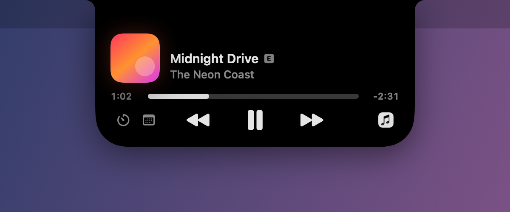
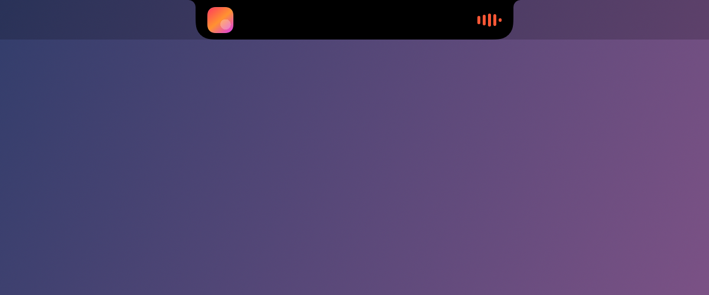
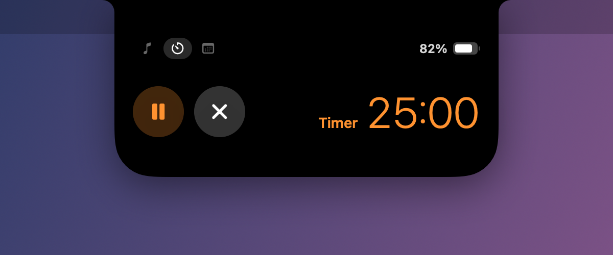
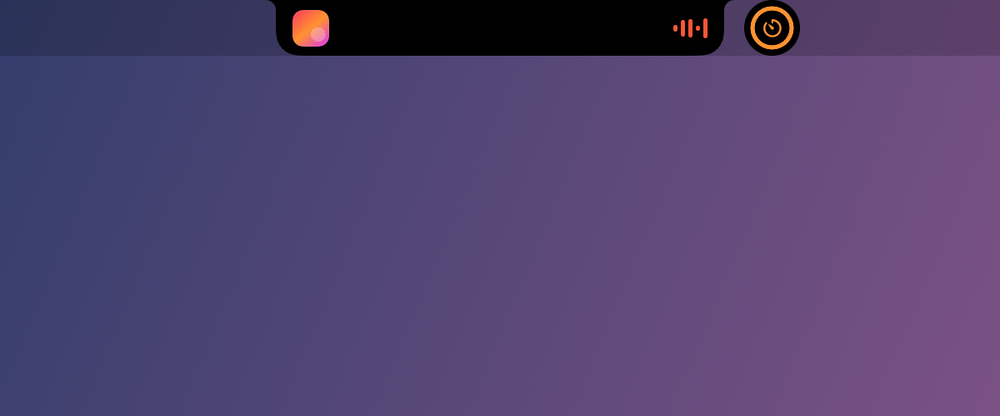
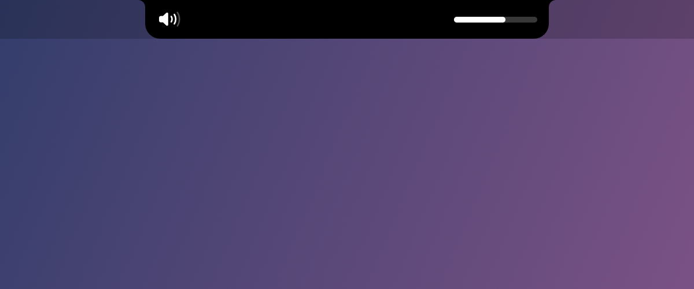
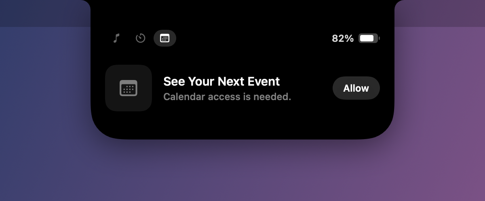
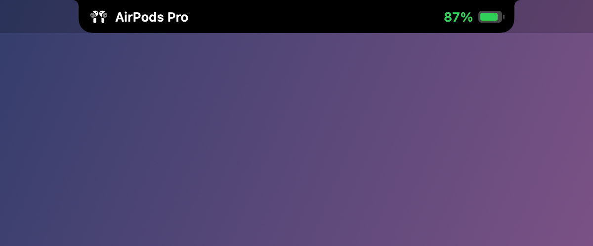
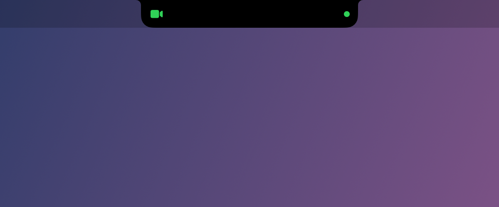
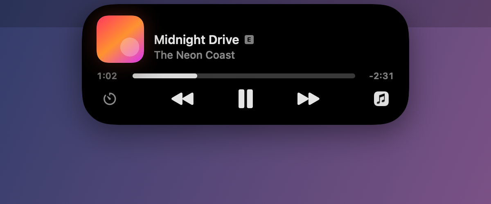

# Dynamic Island for Mac

An iPhone-style **Dynamic Island** that lives in the notch of your MacBook (Air / Pro, Apple silicon). It's built with native SwiftUI, uses the SF Pro system font, and follows Apple's black-pill look with springy morph animations.



## Features

| | |
|---|---|
| 🎵 **Now Playing**: album art in the notch. Hover to get the full player with scrubber, play/pause, next, and previous. Works with **any app**: Apple Music, Spotify, and **browser audio like YouTube** in Safari or Chrome. |  |
| ⏱️ **Timer**: one-click presets (1 min to 1 hr), a countdown in the notch, pause/resume, and a chime when it's done. |  |
| 🫧 **Split island**: when music and a timer run together, the timer pops out into its own bubble, like on iPhone. |  |
| 🔊 **Volume HUD**: changing the volume shows a live level bar. |  |
| 🔋 **Battery**: "Charging" alert when you plug in, a low-battery warning at 20%, and battery % in the expanded header. |  |

| 📅 **Calendar**: a countdown appears when an event is about to start, and a Calendar tab lists what's next. |  |
| 🎧 **Headphones**: name and battery when AirPods or other Bluetooth headphones connect. |  |
| 🟢 **Camera / mic indicator**, plus brief **Focus** and **Caps Lock** alerts. |  |

Other details:
- Timers started in the macOS **Clock app** show up in the island too
- Explicit tracks get the "E" badge
- Starting audio in another app (say a YouTube tab) pauses whatever was playing before, like on iPhone
- Expands on hover (or click), and collapses when you move away or click elsewhere
- Trackpad haptic feedback when the island opens
- Works across all Spaces and over full-screen apps
- On Macs without a notch it shows as a floating pill at the top of the screen
- Menu bar icon with settings: hover-to-expand, haptics, volume HUD, battery alerts, and Launch at Login

## Download

Get the one that matches your Mac from the [latest release](https://github.com/captivcopystudio-byte/dynamic-island-mac/releases/latest):

| Your Mac | Download | What you get |
|---|---|---|
| **Has a notch** (MacBook Air 2022+, MacBook Pro 14"/16") | `DynamicIsland-Notch.zip` | The island grows out of the notch |
| **No notch** (older MacBooks, iMac, Mac mini, external displays) | `DynamicIsland-NoNotch.zip` | A floating pill at the top of the screen, like iPhone |




Unzip, drag **Dynamic Island** to Applications, then right-click it and choose **Open** the first time (the app isn't notarized). Requires **macOS 14.2 or later** on Apple silicon. You can also switch styles any time from the menu bar icon ("Floating Pill Style").

## Build from source

Needs the Xcode Command Line Tools (`xcode-select --install`). You don't need the full Xcode.

```bash
git clone https://github.com/captivcopystudio-byte/dynamic-island-mac.git
cd dynamic-island-mac
make install     # builds "Dynamic Island.app", copies it to /Applications, launches it
```

Other commands:

```bash
make run         # build and run from ./build without installing
make release     # build both downloads (Notch + NoNotch zips) into build/release
make clean
```

### First launch
- Normally no permission prompts are needed. Only if the media helper can't run does the app fall back to AppleScript, and then macOS asks to let **Dynamic Island control "Music"**; click **OK**.
- The app is ad-hoc signed (not notarized). If macOS blocks it, right-click the app → **Open**.
- Turn on **Launch at Login** from the menu bar icon.

## How it works

| Piece | File |
|---|---|
| Transparent panel over the notch, hover hit-testing | `Sources/DynamicIsland/App/IslandController.swift` |
| State machine (idle → compact → expanded, transient alerts) | `App/IslandViewModel.swift` |
| Notch-shaped outline with top "flares" | `Views/Components.swift` (`NotchShape`) |
| Compact live activities | `Views/CompactView.swift` |
| Expanded player / timer | `Views/ExpandedView.swift` |
| Now Playing state and controls (bridge first, AppleScript fallback) | `Services/NowPlayingService.swift` |
| System Now Playing helper (any app, browsers) | `bridge/`, `Services/MediaRemoteBridge.swift` |
| Battery (IOKit), volume (CoreAudio), timer | `Services/SystemServices.swift` |

Notch size comes from `NSScreen.safeAreaInsets` and `auxiliaryTopLeftArea`/`auxiliaryTopRightArea`, so it fits any notched Mac exactly.

> **How browser audio works:** since macOS 15.4, Apple only lets Apple-signed programs read the system's Now Playing info (MediaRemote). The app ships a tiny helper (`bridge/`) that runs inside the system's own `/usr/bin/perl`, reads Now Playing, and relays play/pause/next/seek. If the helper can't run, the app falls back to AppleScript for Music and Spotify.

### Regenerating screenshots
```bash
swift build -c release && .build/release/DynamicIsland --snapshot docs/screenshots
```

## Contributing
PRs are welcome. See [progress.md](progress.md) for the roadmap and what's already done.

## License
MIT. See [LICENSE](LICENSE).

*Not affiliated with Apple. "Dynamic Island" describes the design style.*
