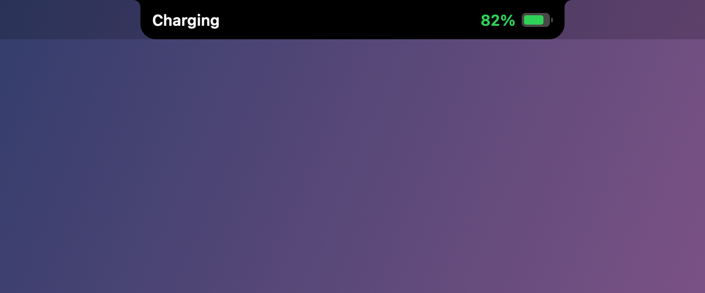

# Dynamic Island for Mac

An iPhone-style **Dynamic Island** that lives in the notch of your MacBook (Air / Pro, Apple silicon). It's built with native SwiftUI, uses the SF Pro system font, and follows Apple's black-pill look with springy morph animations.


## Features

| | |
|---|---|
| 🎵 **Now Playing**: album art and live waveform in the notch. Hover to get the full player with scrubber, play/pause, next, and previous. Works with **Apple Music** and **Spotify**. |  |
| ⏱️ **Timer**: one-click presets (1 min to 1 hr), a countdown in the notch, pause/resume, and a chime when it's done. |  |
| 🫧 **Split island**: when music and a timer run together, the timer pops out into its own bubble, like on iPhone. |  |
| 🔊 **Volume HUD**: changing the volume shows a live level bar. |  |
| 🔋 **Battery**: "Charging" alert when you plug in, a low-battery warning at 20%, and battery % in the expanded header. |  |

Other details:
- Expands on hover (or click), and collapses when you move away or click elsewhere
- Trackpad haptic feedback when the island opens
- Album-tinted waveform colours
- Works across all Spaces and over full-screen apps
- On Macs without a notch it shows as a floating pill at the top of the screen
- Menu bar icon with settings: hover-to-expand, haptics, volume HUD, battery alerts, and Launch at Login

## Install

Requires **macOS 14 or later** on Apple silicon, plus the Xcode Command Line Tools (`xcode-select --install`). You don't need the full Xcode.

```bash
git clone <this-repo-url>
cd dynamic-island
make install     # builds "Dynamic Island.app", copies it to /Applications, launches it
```

Other commands:

```bash
make run         # build and run from ./build without installing
make app         # just build build/Dynamic Island.app
make clean
```

### First launch
- The first time it reads Music or Spotify, macOS asks to let **Dynamic Island control "Music"**. Click **OK**. If you denied it, go to *System Settings › Privacy & Security › Automation* and turn it on.
- The app is ad-hoc signed (not notarized). If macOS blocks it, right-click the app → **Open**.
- Turn on **Launch at Login** from the menu bar icon.

## How it works

| Piece | File |
|---|---|
| Transparent panel over the notch, hover hit-testing | `Sources/DynamicIsland/App/IslandController.swift` |
| State machine (idle → compact → expanded, transient alerts) | `App/IslandViewModel.swift` |
| Notch-shaped outline with top "flares" | `Views/Components.swift` (`NotchShape`) |
| Compact live activities | `Views/CompactView.swift` |
| Expanded player / timer | `Views/ExpandedView.swift` |
| Music & Spotify via Apple Events + distributed notifications | `Services/NowPlayingService.swift` |
| Battery (IOKit), volume (CoreAudio), timer | `Services/SystemServices.swift` |

Notch size comes from `NSScreen.safeAreaInsets` and `auxiliaryTopLeftArea`/`auxiliaryTopRightArea`, so it fits any notched Mac exactly.

> **Why not MediaRemote?** Since macOS 15.4, Apple blocks the private MediaRemote framework for third-party apps, so this project uses AppleScript instead. That's reliable for Music and Spotify, but it can't see browser audio yet (see [progress.md](progress.md)).

### Regenerating screenshots
```bash
swift build -c release && .build/release/DynamicIsland --snapshot docs/screenshots
```

## Contributing
PRs are welcome. See [progress.md](progress.md) for the roadmap and what's already done.

## License
MIT. See [LICENSE](LICENSE).

*Not affiliated with Apple. "Dynamic Island" describes the design style.*
